<p align="center">
  
</p>

<h1 align="center">Unity</h1>

<p align="center">
  A free mental health and wellbeing app for teenagers in Aotearoa New Zealand.<br/>
  <em>Made for teenagers by teenagers.</em>
</p>

<p align="center">
  <a href="https://codemastervy.github.io/unity-app/"><strong>▶ Try the live demo</strong></a>
</p>

> **🚧 Work in progress.** Unity is being built. The final app is a **Progressive Web App (PWA)**,
> installable from the browser on iPhone, Android and desktop, and it works offline. It lives in this repository.
> There are no separate App Store / Play Store apps. A PWA is free to publish, updates instantly
> for everyone, and needs no extra native permissions.
> The GitHub Pages link above is a **demo** for showing the app off. It runs entirely in your browser,
> and accounts and cloud sync are **simulated** (see [Demo mode](#demo-mode)).

> Unity is not a crisis service. If you or someone else is in danger, call **111**.
> To talk to a trained counsellor, free call or text **1737**.

---

## Screenshots

| Home | Journal | Mood tracker | Affirmations |
|---|---|---|---|
| 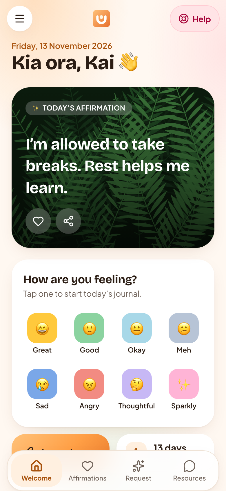 | 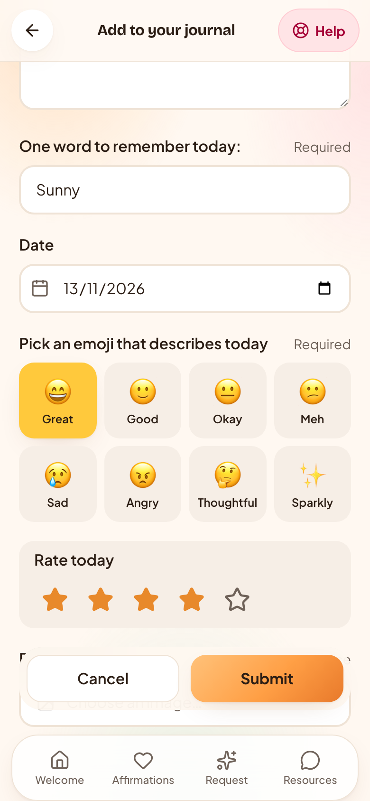 | 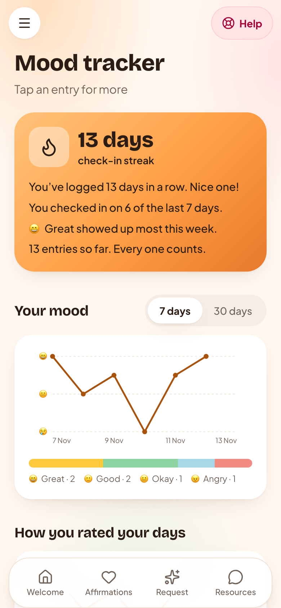 | 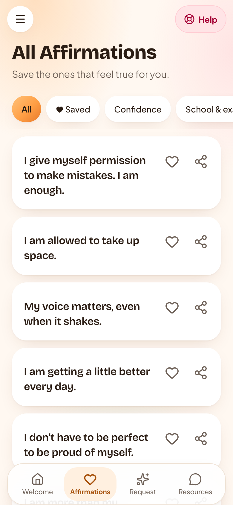 |

| Request | Resources | Need help now? | Health |
|---|---|---|---|
| 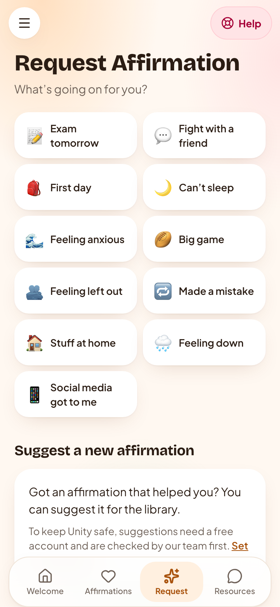 | 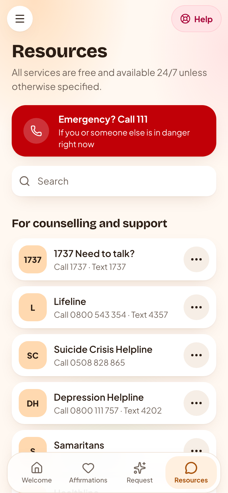 | 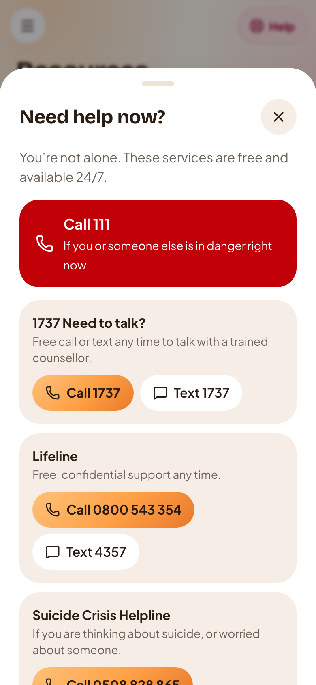 | 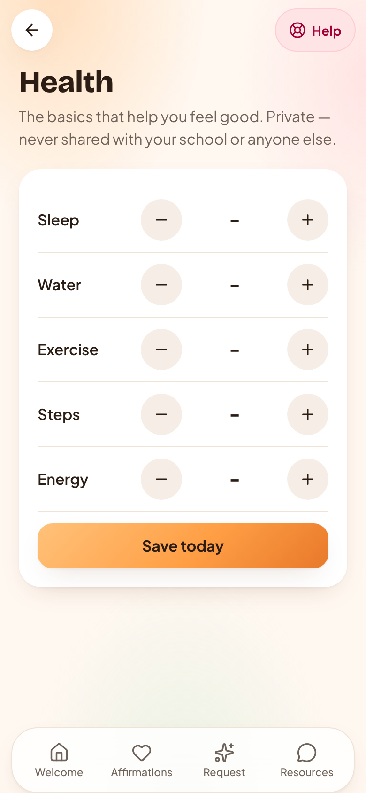 |

**Dark mode**

| Home | Mood tracker | Resources | Account (demo) |
|---|---|---|---|
| 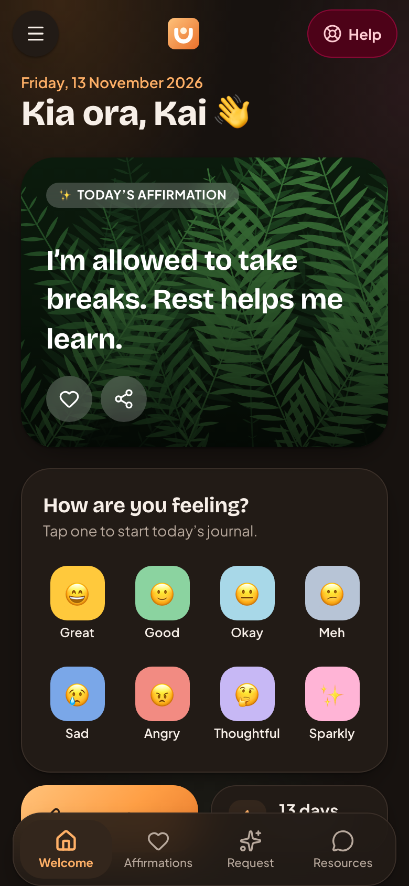 | 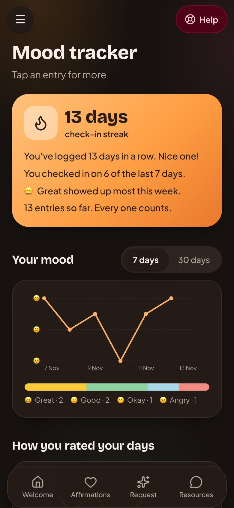 | 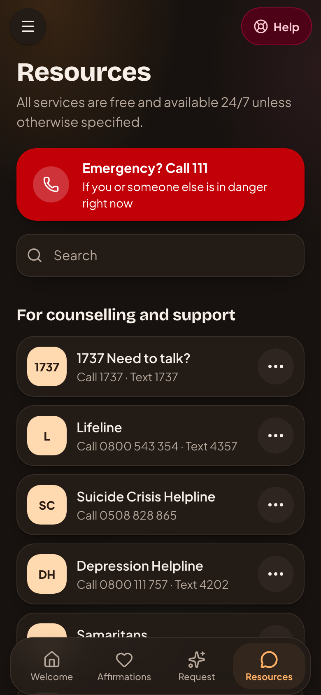 | 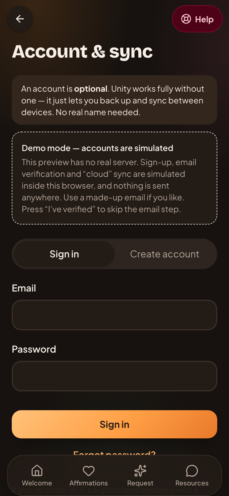 |

More in [`docs/screenshots/`](docs/screenshots).

## Features

- **Daily affirmation** on a calm fern hero, with favourites and share-as-image
- **Journal**: one word, mood emoji, star rating, free text and an optional photo. All of it is **encrypted on the device** (AES-GCM)
- **Mood tracker**: a calendar of mood circles, 7/30-day charts and gentle insight lines (no scores, no diagnoses)
- **All / Request affirmations**: browse by category or pick a situation ("exam tomorrow", "can't sleep"), and suggest new ones for moderation
- **Resources**: a searchable NZ helpline directory with one-tap Call / Text / Visit
- **"Need help now?"**: one tap from every screen (111, 1737, Lifeline, Suicide Crisis Helpline, Youthline)
- **Low-mood card**: gentle, non-blocking support after several low days in a row
- **Health quick-log**: sleep, water, exercise, steps and energy
- **Privacy & security**: PIN app lock, export my data (JSON), delete everything, no ads, no analytics, no tracking
- Optional **account + sync**, with end-to-end encrypted journal fields and a passphrase only you know
- Dark mode, adjustable text size, works offline, installable

## Get it running (one command)

You need [Node.js 20+](https://nodejs.org) and git.

```bash
git clone https://github.com/codemastervy/unity-app.git && cd unity-app && npm ci && npm run dev -- --port 3000
```

Then open **http://localhost:3000**. That gives you exactly what the demo shows, with no accounts or keys needed.

Other commands:

```bash
npm run check        # lint + type-check + unit tests
npm run build        # production build → dist/
npm run preview      # serve the production build locally
npm run test:rules   # Firestore security-rules tests on the emulator (needs Java 11+ and firebase-tools)
```

## Demo mode

Until the real Firebase project exists, Unity uses a **simulated Firebase** (`src/lib/backend.ts`):

- Your journal, moods and settings are stored in your browser (IndexedDB), the same as the real app without an account.
- **Accounts are simulated.** "Create account" stores a hashed password in this browser only. Email verification is skipped with the "I've verified" button, and "cloud sync" goes to a separate local database, so you can try every flow: sign up, journal passphrase, sync, suggestions (rate-limited to one a minute) and delete account.
- The simulator applies the same rules as the real Firestore rules (verified email, owner-only data, ciphertext only).
- **Nothing is ever sent to a server.** There are no API keys, no secrets and no Firebase config anywhere in this repo.

The app switches to real Firebase automatically as soon as a Firebase config is supplied via environment variables (see below).
No code changes are needed.

## Launching for real (Firebase + your own domain)

When it's time to go live, follow **[docs/SETUP.md](docs/SETUP.md)** step by step. In short:

1. Create a Firebase project on the free **Spark** plan, with Firestore in **`australia-southeast1` (Sydney)**. The region can't be changed later.
2. Turn on Auth (email/password with verification, and Google), and register a web app.
3. Copy `.env.example` to `.env` and fill in the web config. **`.env` is git-ignored. Never commit it.**
4. Set up App Check (reCAPTCHA Enterprise) and enforce it, then restrict the API key to your domain.
5. Put your project ID in `.firebaserc`, then deploy the security rules and seed the content:
   ```bash
   npm run test:rules                                   # must pass first
   npx firebase deploy --only firestore:rules,firestore:indexes
   npm run seed:firestore                               # admin key kept OUTSIDE the repo
   ```
6. Build and deploy the PWA to Firebase Hosting, which serves it with a strict CSP, HSTS and other security headers from `firebase.json`:
   ```bash
   npm run deploy
   ```
7. Connect your custom domain in Firebase Hosting → *Add custom domain*, then add it to the API-key and App Check allow-lists.

Before launch, also re-verify every helpline in `src/data/resources.ts`, get the privacy policy reviewed, and read
[docs/BREACH-RESPONSE.md](docs/BREACH-RESPONSE.md).

## How the demo is published

`.github/workflows/pages.yml` runs lint, type-check and tests, then builds with `BASE_PATH=/unity-app/` and deploys to
GitHub Pages on every push to `main`. The build has no secrets and no Firebase config, so it always runs in demo mode.

## Tech

React 19 · Vite · TypeScript · Tailwind CSS v4 · vite-plugin-pwa · Web Crypto (AES-GCM, PBKDF2) · IndexedDB ·
Firebase Auth + Firestore (Spark, optional) · Lucide icons.

| Path | What |
|---|---|
| `src/pages/` | All screens |
| `src/components/` | Layout, tab bar, help sheet, mood calendar, charts, logo |
| `src/lib/crypto.ts` | AES-GCM encryption, passphrase key wrapping, PIN hashing |
| `src/lib/backend.ts` | Real Firebase or the simulated demo backend |
| `src/lib/sync.ts`, `account.ts` | Optional accounts and encrypted sync |
| `src/data/` | Seed affirmations and the helpline directory |
| `firestore.rules`, `tests/rules/` | Deny-by-default security rules and their tests |
| `firebase.json` | Hosting security headers |
| `docs/` | Setup, breach response, screenshots |

## Licence

**Proprietary. © 2026 Isherveer Bhullar. All rights reserved.**
You may view this code and try the demo, but you may **not copy, replicate, modify, share or redistribute** it,
or any part of it, without written permission. See [LICENSE](LICENSE).
